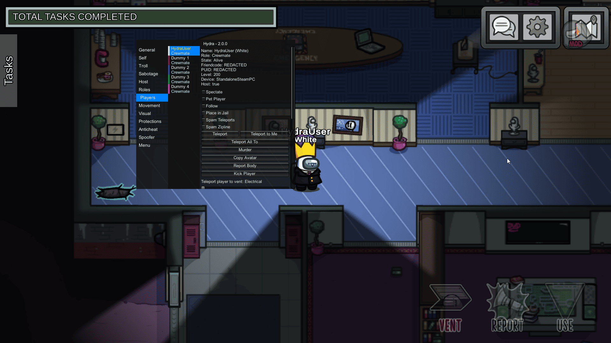

# Hydra 2.1.0 汉化版

<div align="center">
  
</div>

> **汉化 by 微生猫**

Hydra 是一个基于 [BepInEx](https://github.com/BepInEx/BepInEx) 的 Among Us 模组，旨在提升 Among Us 的游戏体验。Hydra 加入了各种便利功能、有趣的整蛊功能，以及一个用于检测房间中作弊玩家的反作弊系统。

本仓库是基于上游 [MrDiamond64/Hydra](https://github.com/MrDiamond64/Hydra) 2.1.0 的**简体中文汉化版本**，在原版基础上做了以下改动：

- **完整中文汉化**：菜单分区、所有开关/按钮/滑块标签、游戏内通知、反作弊检测提示，以及地图地点、管道、破坏项、任务动画等运行时名称均已翻译为中文
- **标题栏署名**：菜单标题栏显示「汉化 by 微生猫」
- **保留原有功能**：配置文件存档、反作弊系统等上游功能均保持不变

原项目 Discord 服务器，欢迎加入交流、寻求帮助或提出建议：https://discord.gg/N7azGPHm5F

# 功能特性

- 无任何 AI 生成代码
- 游戏内通知
- 显示幽灵发送的聊天消息（便于管理时判断玩家行为是否公正）
- 始终显示聊天按钮
- 作为房主翻转 Skeld 地图
- 作为房主始终成为内鬼
- 玩家颜色随机器
- 传送器
- 以船员身份进行破坏和关门
- 设备与版本伪装器
- 查看其他玩家的身份
- [无需房主权限即可将玩家踢出房间](https://streamable.com/wtb7jl)
- [成为无敌状态](https://streamable.com/k1b0m0)
- [可配置的反作弊系统，检测常见外挂与漏洞利用](#hydra-反作弊)
- 更多功能！

# Hydra 反作弊

Hydra 反作弊可以说是本模组的核心。它能检测玩家何时尝试作弊，例如在没有对应身份的情况下钻管道，或在地图中瞬移。检测到作弊者后，Hydra 可以自动将该玩家从房间中封禁。

你**不需要是房主**也可以使用 Hydra 反作弊：非房主时它只会向你发送通知，而不会封禁该玩家。Hydra 反作弊的目标是补充原版 Among Us 反作弊的不足，为其尚未检测的作弊手段增加检查；只要服务器满足一个基本前提，它也可以用在自定义 Among Us 服务器上。

这个基本前提是：后端服务器必须能够阻止玩家冒充他人。如果作弊者能够以其他玩家的名义发送 RPC，那么 Hydra 反作弊将无法准确判断到底是谁在作弊，可能会误判。原版 Among Us 服务器本身就带有冒充检查，因此在官方服务器中通常不必担心这一点。

# 安装与使用

> [!WARNING]
> 使用 Hydra 前，请务必理解并完全同意下方[免责声明](#免责声明)中的警告。

## 安装 BepInEx

[BepInEx](https://github.com/bepinex/bepinex) 是一个为 Unity 游戏制作模组的框架。Among Us 使用 Unity 引擎，因此 Hydra 通过 BepInEx 来修改游戏。在安装 Hydra 之前，你需要先安装 BepInEx。

BepInEx 有多个版本，我们需要 **Il2Cpp 版本**，因为 Among Us 使用 Il2Cpp 编译器以实现跨平台兼容。你可以从本仓库的 Releases 页面下载，也可以从 [BepInEx 官网](https://builds.bepinex.dev/projects/bepinex_be)获取。

请注意 BepInEx Il2Cpp 分为 x86 和 x64 两种架构，这很重要：Among Us 本身可能是 32 位或 64 位，取决于你的下载来源，**BepInEx 的架构必须与你的 Among Us 一致**。一般规律是：Steam、Microsoft Store、Epic Games 提供的是 x64 版本，Itch.io 提供的是 x86 版本。如果不确定，可以按 `Ctrl` + `Shift` + `Esc` 打开任务管理器，在进程列表中找到 Among Us，看是否显示「Among Us.exe (32 位)」：显示则是 32 位，否则为 64 位。

下载好对应架构的 BepInEx 后，打开你的 Among Us 安装目录（即 `Among Us.exe` 和 `GameAssembly.dll` 所在目录），把 BepInEx 的内容解压进去。解压后，除了 `Among Us.exe`，你应当还能看到 `winhttp.dll`、`BepInEx`、`dotnet` 等新文件和文件夹。如果没看到，说明解压程序把它们放进了单独的子文件夹，请打开该文件夹，把所有内容拖到 `Among Us.exe` 所在的同一目录。一切正确的话，BepInEx 就安装完成了。

## 安装 Hydra 汉化版

1. 前往本仓库右侧的 [Releases](https://github.com/NikoCatvo/hydra-chinese/releases) 页面
2. 下载最新版本的 `HydraMenu.dll`
3. 把它复制粘贴到 `./BepInEx/plugins/` 目录（**替换同名文件，不要同时保留两份**）
4. 启动 Among Us

首次安装 BepInEx 后启动 Among Us 会与平时不同：启动可能明显变慢，并会出现一个终端窗口。这是完全正常的，属于 BepInEx 的预检流程，之后的启动不会再有这个延迟。稍等片刻后 Among Us 会打开，屏幕右上角应出现一个模组图标，此时 Hydra 汉化版就已经就绪了。

## 使用 Hydra

按键盘上的 `Insert` 键即可打开/关闭 Hydra 界面。根据你的键盘，可能需要切换 Num Lock，或配合 Fn 键一起按。

Hydra 界面分为两部分：**分区栏**和**功能栏**。分区栏列出了诸如「自身」「房主」「反作弊」等标签页，点击任意一个标签，功能栏就会显示该分区的功能。功能栏中包含滑块、按钮和开关，可以用来配置 Hydra。

在「菜单」分区中，可以设置主题色、菜单不透明度、界面缩放，以及保存/加载配置文件。

# 从源码构建

需要 .NET 6（或更高版本）SDK，以及可访问 NuGet 的网络环境：

```bash
cd src
dotnet restore
dotnet build -c Release
```

产物位于 `src/bin/Release/net6.0/HydraMenu.dll`。由于项目依赖 `AmongUs.GameLibs.Steam`，需要能够访问项目内配置的 NuGet 源。

# 免责声明

> [!CAUTION]
> **Hydra 在任何情况下都绝不应被用于破坏其他玩家的游戏体验。如果你使用了部分整蛊功能，请确保是在私人房间中，并且获得了在场玩家的同意。只要你抱着改善游戏体验的目的，你完全可以在公开房间中启用 Hydra。能力越大，责任越大！**

我认识到，像 Hydra 这样的工具型模组会为恶意用户在房间里搞破坏打开大门。我已经通过移除公开版本中威力过大、容易被滥用的功能，并加入限制滥用的保护措施来降低风险。即便有这些保护，滥用和恶意行为仍有可能发生。我能做的只是请求你——正在使用 Hydra 的人——不要将 Hydra 用于恶意目的，并遵守 [Innersloth 行为准则](https://www.innersloth.com/code-of-conduct/)以及你所在房间的规则。请只用它来在公开房间中检测作弊者，或在所有人都同意的情况下使用 Hydra 的进阶功能。

如果你不听从我的建议，那么不要指望从我这里获得任何形式的支持或承担任何责任。你的账号也可能会被 Innersloth 处以制裁，你将失去你的 Among Us 账号以及与之关联的所有数据，例如好友列表、已解锁的装饰、已购内容、豆子和金币等。

本模组与 Among Us 或 Innersloth LLC 无关，其中所含内容不由 Innersloth LLC 认可或赞助。本文所含部分素材为 Innersloth LLC 的财产。© Innersloth LLC。

# 许可协议

本仓库沿用上游 Hydra 的许可协议：**GNU General Public License v3.0**（详见 [LICENSE](LICENSE)）。

- 上游项目：[MrDiamond64/Hydra](https://github.com/MrDiamond64/Hydra)
- 汉化：微生猫
